# Lab: Site-to-Site IPsec VPN (GCP Classic VPN to Sangfor Firewall)

Panduan deployment dan konfigurasi Site-to-Site IPsec VPN Policy-Based antara **Google Cloud Platform (GCP)** pada project **`dev-aji`** region **`asia-southeast2` (Jakarta)** dan **Sangfor Next-Generation Firewall (NGAF)**.

---

## 1. Arsitektur & Topologi Jaringan

```mermaid
flowchart LR
    subgraph GCP["Google Cloud Platform (dev-aji | asia-southeast2 - Jakarta)"]
        direction TB
        VM["GCP Instances<br/>Subnet: 10.184.0.0/20"]
        VPC["VPC Network: default"]
        GW["Target VPN Gateway<br/>vpn-gw-sangfor-lab"]
        IP_GCP["Static External IP<br/>(gcp-vpn-ip-lab)"]
        VM --> VPC --> GW --- IP_GCP
    end

    subgraph Internet["Public Internet / IPsec Tunnel"]
        Tunnel["IPsec Tunnel (IKEv2)<br/>ESP / UDP 500 / UDP 4500<br/>Policy-Based Selector"]
    end

    subgraph OnPrem["Sangfor Customer / On-Premise"]
        direction TB
        IP_SNG["Public IP WAN<br/>103.196.44.66"]
        NGAF["Sangfor Firewall (NGAF)"]
        LAN["Remote LAN Subnet<br/>192.168.10.0/24 (Dummy)"]
        IP_SNG --- NGAF --> LAN
    end

    IP_GCP <===> Tunnel <===> IP_SNG
```



---

## 2. Tabel Parameter Koneksi

| Parameter | Sisi GCP (Local) | Sisi Sangfor (Remote) | Catatan |
| :--- | :--- | :--- | :--- |
| **GCP Project ID** | `dev-aji` | - | Project target di GCP |
| **Region** | `asia-southeast2` (Jakarta) | - | Lokasi resource VPN GCP |
| **VPC Network** | `default` | - | Jaringan VPC yang digunakan |
| **Public Endpoint IP** | Dinamis (Hasil Step 1) | `103.196.44.66` | Diberikan oleh ISP masing-masing |
| **Local Subnet (CIDR)** | `10.184.0.0/20` | `192.168.10.0/24` | Harus simetris (Mirror) |
| **Remote Subnet (CIDR)** | `192.168.10.0/24` | `10.184.0.0/20` | Harus simetris (Mirror) |
| **IKE Version** | `IKEv2` | `IKEv2` | Pastikan versi sama |
| **Pre-Shared Key (PSK)** | `vcw1nAT5S4+Fnv+JoziDLsU1kjs1/+MQ` | `vcw1nAT5S4+Fnv+JoziDLsU1kjs1/+MQ` | Wajib identik tanpa spasi |
| **Routing Method** | Policy-Based + Static Route | Policy-Based / Route-Based | Tanpa BGP |

---

## 3. Struktur Project

```text
gcp-sangfor-vpn/
├── README.md          # Dokumentasi teknis & panduan lengkap
├── setup-vpn.sh       # Script bash otomasi deployment (untuk Cloud Shell / Linux)
├── setup-vpn.ps1      # Script PowerShell otomasi deployment (untuk Windows)
├── verify-vpn.sh      # Script inspeksi status tunnel, gateway, route, dan firewall
└── cleanup-vpn.sh     # Script pembersihan (teardown) seluruh resource lab
```

---

## 4. Cara Menjalankan Konfigurasi di GCP

Pastikan project CLI aktif Anda adalah `dev-aji`:
```bash
gcloud config set project dev-aji
```

### Opsi A: Menggunakan Script Otomatis (Direkomendasikan)
Cukup jalankan script bash di Google Cloud Shell / Linux:
```bash
chmod +x setup-vpn.sh verify-vpn.sh cleanup-vpn.sh
./setup-vpn.sh
```
Atau jika menjalankan dari PowerShell lokal (Windows):
```powershell
.\setup-vpn.ps1
```

### Opsi B: Menjalankan Perintah gcloud Manual Step-by-Step

<details>
<summary><b>Klik untuk melihat langkah manual gcloud</b></summary>

#### Langkah 1: Pesan IP Publik Statis Regional
```bash
gcloud compute addresses create gcp-vpn-ip-lab \
    --project=dev-aji \
    --region=asia-southeast2 \
    --network-tier=PREMIUM
```
Cek IP yang didapat:
```bash
gcloud compute addresses describe gcp-vpn-ip-lab --project=dev-aji --region=asia-southeast2 --format="value(address)"
```

#### Langkah 2: Buat Target VPN Gateway
```bash
gcloud compute target-vpn-gateways create vpn-gw-sangfor-lab \
    --project=dev-aji \
    --network=default \
    --region=asia-southeast2
```

#### Langkah 3: Buat 3 Forwarding Rules
```bash
# Rule ESP (Payload IPsec)
gcloud compute forwarding-rules create fr-vpn-esp \
    --project=dev-aji \
    --region=asia-southeast2 \
    --ip-protocol=ESP \
    --address=gcp-vpn-ip-lab \
    --target-vpn-gateway=vpn-gw-sangfor-lab

# Rule UDP 500 (IKE)
gcloud compute forwarding-rules create fr-vpn-udp500 \
    --project=dev-aji \
    --region=asia-southeast2 \
    --ip-protocol=UDP \
    --ports=500 \
    --address=gcp-vpn-ip-lab \
    --target-vpn-gateway=vpn-gw-sangfor-lab

# Rule UDP 4500 (NAT-T)
gcloud compute forwarding-rules create fr-vpn-udp4500 \
    --project=dev-aji \
    --region=asia-southeast2 \
    --ip-protocol=UDP \
    --ports=4500 \
    --address=gcp-vpn-ip-lab \
    --target-vpn-gateway=vpn-gw-sangfor-lab
```

#### Langkah 4: Buat VPN Tunnel Policy-Based
```bash
gcloud compute vpn-tunnels create tunnel-to-sangfor \
    --project=dev-aji \
    --region=asia-southeast2 \
    --peer-address=103.196.44.66 \
    --shared-secret="vcw1nAT5S4+Fnv+JoziDLsU1kjs1/+MQ" \
    --ike-version=2 \
    --local-traffic-selector=10.184.0.0/20 \
    --remote-traffic-selector=192.168.10.0/24 \
    --target-vpn-gateway=vpn-gw-sangfor-lab
```

#### Langkah 5: Buat Rute Statis ke Subnet Sangfor
```bash
gcloud compute routes create route-to-sangfor-lab \
    --project=dev-aji \
    --network=default \
    --next-hop-vpn-tunnel=tunnel-to-sangfor \
    --next-hop-vpn-tunnel-region=asia-southeast2 \
    --destination-range=192.168.10.0/24
```

#### Langkah 6: Buka Firewall GCP Ingress
```bash
gcloud compute firewall-rules create allow-vpn-from-sangfor \
    --project=dev-aji \
    --network=default \
    --direction=INGRESS \
    --action=ALLOW \
    --source-ranges=192.168.10.0/24 \
    --rules=tcp,udp,icmp
```
</details>

---

## 5. Panduan Konfigurasi di Sisi Sangfor Firewall (NGAF)

Saat mengatur IPsec VPN di Web Console Sangfor NGAF:

1. **Basic Settings / Peer Info:**
   - **Tunnel Name**: `GCP-VPN-Lab`
   - **Remote Peer IP**: Masukkan IP Publik GCP hasil Step 1.
   - **Authentication**: Pre-Shared Key (`vcw1nAT5S4+Fnv+JoziDLsU1kjs1/+MQ`).
   - **IKE Version**: `IKEv2`.

2. **Traffic Selectors / Encrypted Subnets:**
   - **Local Subnet**: `192.168.10.0/24` *(jaringan lokal Sangfor)*
   - **Remote Subnet**: `10.184.0.0/20` *(jaringan VPC GCP `dev-aji` Jakarta)*

3. **Phase 1 Proposal (IKE SA):**
   - **Encryption Algorithm**: `AES-256` atau `AES-128`
   - **Authentication / Hash**: `SHA-256`
   - **DH Group**: `Group 14 (2048-bit)` atau `Group 2`
   - **SA Lifetime**: `36000` detik (10 jam)

4. **Phase 2 Proposal (IPsec SA):**
   - **Encapsulation**: `ESP`
   - **Encryption Algorithm**: `AES-256` atau `AES-128`
   - **Authentication / Hash**: `SHA-256`
   - **PFS (Perfect Forward Secrecy)**: `Group 14` (atau *Disabled* jika disesuaikan)
   - **SA Lifetime**: `10800` detik (3 jam)

5. **Sangfor Security Policy:**
   - Pastikan terdapat policy yang mengizinkan traffic dari zone LAN ke zone VPN (dan sebaliknya).

---

## 6. Verifikasi & Troubleshooting

Jalankan script verifikasi:
```bash
./verify-vpn.sh
```

### Arti Status Tunnel di GCP Console:
- **`ESTABLISHED`**: Tunnel terhubung sempurna, IKE Phase 1 & Phase 2 sukses.
- **`First handshake`**: GCP sedang menunggu paket inisiasi/respon dari Sangfor. Cek apakah IP Publik GCP sudah dimasukkan di Sangfor dan port UDP 500/4500 tidak terblokir ISP.
- **`Waiting for peer`**: Sangfor belum memicu koneksi (GCP bersifat pasif menunggu traffic).
- **`Negotiation failed` / `TS_UNACCEPTABLE`**: Traffic Selector tidak cocok (ada perbedaan subnet antara local dan remote) atau PSK salah.

---

## 7. Cara Mengubah Remote Subnet (Bila Info Customer Sudah Ada)

> **PENTING:** Parameter `--remote-traffic-selector` pada tunnel GCP bersifat permanen (*immutable*). Jika IP Sangfor yang asli sudah diperoleh:

1. Hapus rute lama:
   ```bash
   gcloud compute routes delete route-to-sangfor-lab --project=dev-aji --quiet
   ```
2. Hapus tunnel lama:
   ```bash
   gcloud compute vpn-tunnels delete tunnel-to-sangfor --region=asia-southeast2 --project=dev-aji --quiet
   ```
3. Buat ulang tunnel & route dengan subnet baru menggunakan file `setup-vpn.sh` (cukup ubah variabel `REMOTE_TRAFFIC_SELECTOR` di baris atas script).
